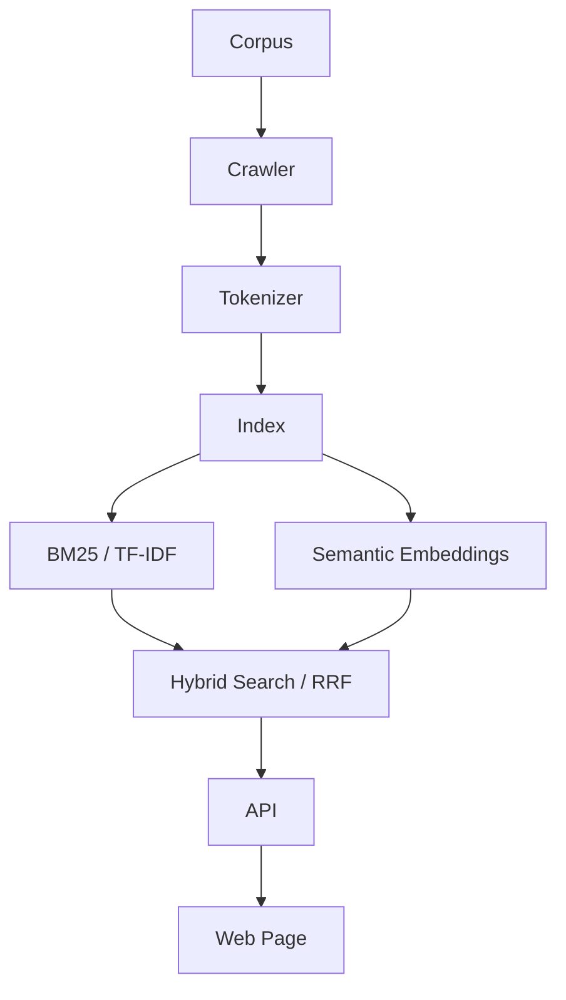

# Лабораторна робота №8. Швидше, потім розумніше: профілювання, NumPy і семантичний пошук

## 1. Мета роботи

Мета лабораторної роботи — дослідити продуктивність пошукової системи Findex, визначити основні вузькі місця, оптимізувати обчислення за допомогою NumPy та розширити пошук семантичними можливостями.

## 2. Основні завдання

У межах лабораторної роботи розглядаються такі напрями:

- профілювання індексації та пошуку;
- аналіз часу виконання окремих функцій;
- оптимізація структури інвертованого індексу;
- використання NumPy для векторизованих обчислень BM25 і TF-IDF;
- реалізація семантичного пошуку на основі векторних представлень тексту;
- об'єднання результатів лексичного та семантичного пошуку;
- оцінювання якості та продуктивності пошукової системи.

## 3. Профілювання продуктивності

Для аналізу продуктивності використовуються:

- `cProfile` — профілювання часу виконання функцій Python;
- `py-spy` — зовнішнє профілювання процесу;
- `Scalene` — аналіз часу виконання Python-коду та нативних операцій;
- `pytest-benchmark` — вимірювання продуктивності окремих функцій.

Профілювання перед оптимізацією повинно охоплювати дві основні операції:

1. Побудову індексу (`findex index`).
2. Виконання пошукового запиту (`findex search`).

Результати профілювання:

| Операція | Час виконання | Основне вузьке місце |
|---|---:|---|
| Побудова індексу | — | Потребує вимірювання |
| Пошуковий запит | — | Потребує вимірювання |

## 4. Оптимізація за допомогою NumPy

Для оптимізації обчислень використовується бібліотека NumPy.

Основні зміни:

- ідентифікатори документів зберігаються в масивах `int32`;
- частоти термінів зберігаються в масивах `int32`;
- довжини документів представлені одним масивом `int32`;
- обчислення BM25 та TF-IDF виконуються за допомогою векторизованих операцій;
- для вибору найкращих результатів використовується `numpy.argpartition`.

### BM25

BM25 враховує частоту терміна в документі, довжину документа та IDF — обернену частоту документа.

Формула:

\[
BM25(q,d)=\sum_{t \in q} IDF(t)
\cdot
\frac{f(t,d)(k_1+1)}
{f(t,d)+k_1(1-b+b\frac{|d|}{avgdl})}
\]

### TF-IDF

TF-IDF використовується для оцінювання важливості терміна в документі.

\[
TFIDF(t,d)=TF(t,d)\cdot IDF(t)
\]

Векторизація дозволяє виконувати операції над цілими масивами замість послідовної обробки кожного елемента в Python.

## 5. Порівняння продуктивності

Для порівняння необхідно виміряти три типи запитів:

- запит із частим терміном;
- запит із рідкісним терміном;
- запит із трьома термінами.

| Тип запиту | Початковий алгоритм, мс | NumPy, мс | Прискорення |
|---|---:|---:|---:|
| Частий термін | — | — | — |
| Рідкісний термін | — | — | — |
| Три терміни | — | — | — |

Невелике прискорення на коротких списках входжень може пояснюватися накладними витратами на створення масивів та виклик NumPy.

## 6. Семантичний пошук

Семантичний пошук дозволяє знаходити документи не лише за точним збігом слів, а й за змістом запиту.

Для створення векторних представлень використовується модель:

`sentence-transformers/all-MiniLM-L6-v2`

Основні етапи:

1. Текст документа поділяється на окремі фрагменти.
2. Для кожного фрагмента створюється embedding.
3. Вектори нормалізуються.
4. Матриця векторів зберігається у форматі `.npy`.
5. Для пошукового запиту створюється власний вектор.
6. Обчислюється косинусна подібність між запитом і фрагментами документів.
7. Для кожного документа враховується найкращий результат серед його фрагментів.

## 7. Гібридний пошук

Гібридний пошук поєднує результати лексичного BM25 та семантичного пошуку.

Для об'єднання використовується Reciprocal Rank Fusion (RRF).

\[
RRF(d)=\sum_{r \in R}\frac{1}{k+rank_r(d)}
\]

Такий підхід дозволяє враховувати як точний збіг термінів, так і змістову близькість документів до запиту.

Передбачені режими:

| Режим | Принцип роботи |
|---|---|
| Lexical | Пошук за словами |
| Semantic | Пошук за змістом |
| Hybrid | Об'єднання лексичного та семантичного пошуку |

## 8. Оцінювання якості пошуку

Для оцінювання семантичного пошуку використовується метрика Precision@5.

Вона показує частку релевантних документів серед перших п'яти результатів.

\[
Precision@5=\frac{\text{Кількість релевантних документів у топ-5}}{5}
\]

Для оцінювання передбачено:

- 10 звичайних пошукових запитів;
- 5 перефразованих запитів, у яких не використовуються слова з документів.

| Тип запитів | Кількість | Precision@5 |
|---|---:|---:|
| Звичайні запити | 10 | — |
| Перефразовані запити | 5 | — |

## 9. Архітектура системи

## 10. Використані технології

| Технологія | Призначення |
|---|---|
| Python | Основна мова програмування |
| NumPy | Векторизовані обчислення |
| Sentence Transformers | Створення embeddings |
| cProfile | Профілювання Python-коду |
| py-spy | Аналіз виконання процесу |
| Scalene | Аналіз Python та native часу |
| pytest | Автоматизоване тестування |
| pytest-benchmark | Вимірювання продуктивності |
| FastAPI | HTTP API |

## 11. Висновки

Під час виконання лабораторної роботи розглянуто методи аналізу та оптимізації пошукової системи Findex.

Розглянуто використання NumPy для зберігання числових даних у компактних масивах і виконання векторизованих обчислень. Також розглянуто семантичний пошук на основі embeddings та гібридний підхід, який поєднує лексичне й семантичне ранжування.

Профілювання дозволяє визначати найбільш витратні операції, а порівняння результатів до та після оптимізації — оцінювати ефективність внесених змін.

**Підсумок:** лабораторна робота демонструє підходи до підвищення продуктивності пошукової системи та покращення релевантності результатів пошуку.